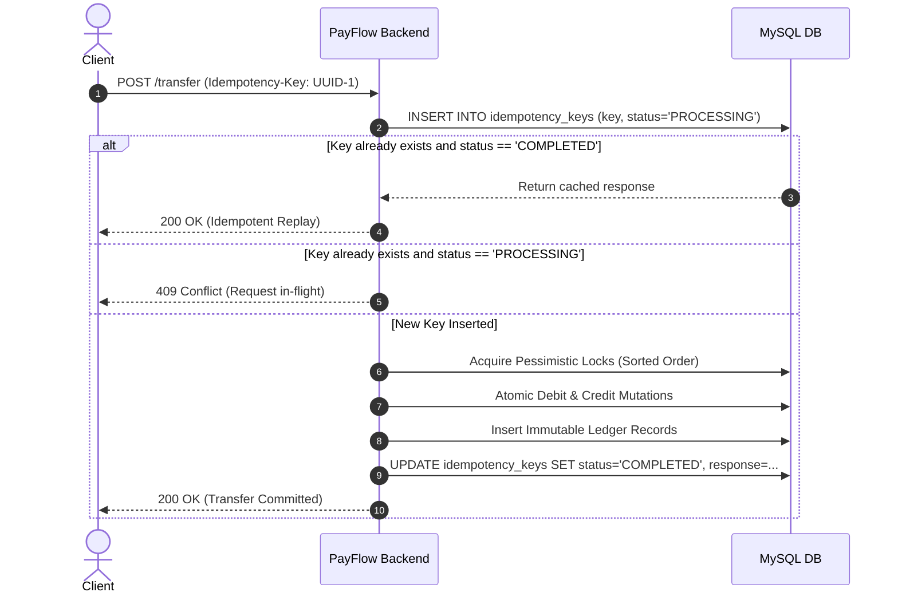

# PayFlow | Secure Digital Wallet & Transaction Processing Engine

[](https://www.oracle.com/java/technologies/javase/jdk17-archive-downloads.html)
[](https://spring.io/projects/spring-boot)
[](https://spring.io/projects/spring-security)
[](https://www.mysql.com/)
[](https://nextjs.org/)
[](https://www.typescriptlang.org/)
[](https://www.docker.com/)

**PayFlow** is a production-grade, highly reliable digital wallet and transaction processing engine. It solves critical fintech engineering challenges including **concurrent double-spending**, **database deadlocks**, **network duplicate transactions (idempotency)**, and **financial audit reconciliation** via immutable double-entry bookkeeping.

---

## 🏛️ System Architecture

```mermaid
flowchart TD
    Client([Next.js Client / Mobile App])
    API_Gateway[Spring Security Filter Chain\nJWT Stateless Auth + CORS]
    Idempotency[Idempotency Interceptor\nUnique Key & Payload Hash Check]
    TxnEngine[Transaction Core Service\nDeterministic Lock Ordering]
    LedgerService[Immutable Ledger Service\nDouble-Entry Debit/Credit Posting]
    MySQL[(MySQL 8.0 Database\nInnoDB Engine)]

    Client -->|HTTPS + Bearer JWT + Idempotency-Key| API_Gateway
    API_Gateway --> Idempotency
    Idempotency -->|Key Validated / Lock Acquired| TxnEngine
    TxnEngine -->|SELECT ... FOR UPDATE (Sorted Wallet IDs)| MySQL
    TxnEngine -->|Atomic Debit & Credit| LedgerService
    LedgerService -->|Append Ledger Entries| MySQL
    TxnEngine -->|Commit Transaction & Cache Response| Idempotency
```

---

## ⚡ Core Technical Challenges & Hardened Solutions

### 1. Database Concurrency & Race Conditions (The "Double Spend" Hazard)
* **The Vulnerability:** If a user with \$100 initiates two simultaneous \$100 transfers across parallel threads, standard ORM updates can read balance = \$100 simultaneously, subtract \$100 in both, and result in a balance of -\$100.
* **The Solution:** 
  * Exclusive row-level locking via JPA **Pessimistic Write Locking** (`@Lock(LockModeType.PESSIMISTIC_WRITE)` translates to `SELECT ... FOR UPDATE` in MySQL InnoDB).
  * Transactions run under `READ_COMMITTED` isolation to ensure rows are updated atomically before releasing locks.

### 2. Deadlock Elimination (Deterministic Lock Ordering)
* **The Vulnerability:** If User A sends money to User B while User B simultaneously sends money to User A, Thread 1 locks Wallet A and requests Wallet B, while Thread 2 locks Wallet B and requests Wallet A. This triggers an immediate MySQL `Deadlock found when trying to get lock`.
* **The Solution:** **Deterministic Lock Ordering Algorithm**. Wallets are locked sequentially based on primary key sorting (`min(sourceId, targetId)` first, then `max(sourceId, targetId)`), completely eliminating circular wait conditions:

```java
// Deterministic Lock Ordering in TransactionService.java
Long firstLockId = sourceId < targetId ? sourceId : targetId;
Long secondLockId = sourceId < targetId ? targetId : sourceId;

Wallet first = walletRepository.findByIdForUpdate(firstLockId);
Wallet second = walletRepository.findByIdForUpdate(secondLockId);
```

### 3. Distributed Idempotency Protection
* **The Vulnerability:** Network timeouts or client-side double-taps can cause the same transfer request to hit the server twice.
* **The Solution:**
  * Endpoints inspect the `Idempotency-Key` HTTP header (UUID).
  * An `idempotency_keys` table enforces database-level unique constraints.
  * State transitions: `PROCESSING` -> `COMPLETED` or `FAILED`.
  * If an identical request arrives while `PROCESSING`, HTTP `409 CONFLICT` is returned. If already `COMPLETED`, the previous response is replayed safely from cache without re-executing ledger mutations.



### 4. Immutable Double-Entry Ledger Bookkeeping
* Rather than simply mutating an arbitrary `balance` column, PayFlow records an immutable journal of `DEBIT` and `CREDIT` entries for every transaction.
* Continuous reconciliation check:
$$\text{Wallet Balance} \equiv \sum \text{Credits} - \sum \text{Debits}$$
* Any balance drift triggers an immediate system audit exception.

### 5. Monetary Arithmetic Precision
* Standard IEEE floating point (`float`, `double`) produces truncation errors (e.g., $0.1 + 0.2 = 0.30000000000000004$).
* PayFlow enforces `BigDecimal` configured with `scale = 4`, `RoundingMode.HALF_EVEN` for persistent storage, and `DECIMAL(19, 4)` in MySQL.

---

## 🛠️ Tech Stack & Directory Structure

```
payflow/
├── backend/                  # Java 17, Spring Boot 3.3.0
│   ├── src/main/java/com/payflow/
│   │   ├── config/           # Security, JWT filter, Swagger OpenAPI, CORS
│   │   ├── controller/       # Auth, Wallet, Transaction, Ledger endpoints
│   │   ├── dto/              # Strongly-typed request/response models
│   │   ├── entity/           # JPA Entities (User, Wallet, Transaction, Ledger, Idempotency)
│   │   ├── exception/        # Global exception handling & mapped HTTP errors
│   │   ├── repository/       # Spring Data JPA repositories with row-level locks
│   │   ├── service/          # Core transaction engine, ledger auditing, JWT, auth
│   │   └── util/             # BigDecimal currency utilities
│   ├── src/test/             # Multi-threaded concurrency & unit test suites
│   ├── pom.xml
│   └── Dockerfile
├── frontend/                 # Next.js 14, TypeScript, Tailwind CSS
│   ├── src/app/              # App router (Landing, Dashboard, Login, Register)
│   ├── src/components/       # WalletCard, TransferModal, TransactionTable, LedgerTable
│   ├── src/lib/              # Fetch API client, idempotency key generation, auth tokens
│   └── Dockerfile
├── docker-compose.yml        # Orchestration (MySQL 8, Backend, Frontend)
└── README.md
```

---

## 🚀 Quick Start (Docker Compose)

The easiest way to run the entire stack (Database, Backend, and Frontend) is via Docker Compose:

```bash
# Clone the repository
git clone https://github.com/your-username/payflow.git
cd payflow

# Start all services with one command
docker compose up --build
```

Once started:
* **Frontend Web App:** [http://localhost:3000](http://localhost:3000)
* **Backend REST API:** [http://localhost:8080](http://localhost:8080)
* **Swagger / OpenAPI Documentation:** [http://localhost:8080/swagger-ui.html](http://localhost:8080/swagger-ui.html)
* **MySQL Database:** `localhost:3306` (Database: `payflow_db`, User: `payflow_user`, Password: `payflow_secure_password`)

---

## 🧪 Concurrency Stress Testing

PayFlow includes an automated multi-threaded concurrency suite that simulates aggressive race conditions and bi-directional deadlock hazards:

```bash
cd backend
mvn test
```

### Verified Test Cases (`TransactionServiceConcurrencyTest.java`):
1. **Parallel Double-Spend Stress Test:**
   * **Scenario:** A wallet with \$100 receives 10 simultaneous \$20 transfer requests across concurrent worker threads.
   * **Expected Outcome:** Exactly 5 transfers succeed, exactly 5 fail with `InsufficientBalanceException`. Ending sender balance is strictly \$0.00, receiver balance is strictly \$100.00.
2. **Bi-directional Deadlock Elimination Test:**
   * **Scenario:** Multiple concurrent threads execute transfers from Account A to Account B while equal threads execute transfers from Account B to Account A simultaneously.
   * **Expected Outcome:** All transfers execute without hitting MySQL deadlock timeout due to deterministic lock sorting.

---

## 📡 REST API Reference

| Method | Endpoint | Description | Auth Required |
| :--- | :--- | :--- | :--- |
| `POST` | `/api/v1/auth/register` | Register user & auto-provision digital wallet | No |
| `POST` | `/api/v1/auth/login` | Authenticate & retrieve JWT bearer token | No |
| `GET` | `/api/v1/wallets/me` | Fetch active wallet balance & audit status | Yes |
| `POST` | `/api/v1/wallets/{walletNumber}/deposit` | Deposit funds (supports `Idempotency-Key`) | Yes |
| `POST` | `/api/v1/transactions/transfer` | Atomic P2P money transfer (supports `Idempotency-Key`) | Yes |
| `GET` | `/api/v1/transactions/my-transactions`| Paginated transaction history | Yes |
| `GET` | `/api/v1/ledger/my-entries` | Double-entry debit/credit ledger records | Yes |
| `GET` | `/api/v1/ledger/audit` | Reconcile wallet balance with ledger entries | Yes |

---

## 💡 Interview Preparation Cheat Sheet

When discussing this project in technical interviews, focus on these key talking points:

1. **Why did you use Pessimistic Locking instead of Optimistic Locking?**
   * *Answer:* "Optimistic locking (`@Version`) works well for read-heavy systems where collisions are rare. But in high-frequency financial wallets, concurrent transfers would cause frequent `OptimisticLockException` rollbacks, degrading user experience. Pessimistic write locking (`SELECT ... FOR UPDATE`) guarantees serial execution on the hot wallet record without throwing retry burdens onto callers."

2. **How did you prevent database deadlocks?**
   * *Answer:* "Bi-directional transfers between two accounts (A &rarr; B and B &rarr; A) cause deadlocks if threads acquire locks in opposing order. I implemented **deterministic lock ordering**: before locking rows, the service sorts the two wallet IDs and always acquires the lock on the lower ID first, followed by the higher ID. This eliminates circular wait conditions mathematically."

3. **How does your idempotency mechanism work?**
   * *Answer:* "Clients generate a UUID and pass it via the `Idempotency-Key` header. Before mutating balance, an isolated transaction records the key with status `PROCESSING`. A database-level unique constraint prevents concurrent duplicates. Upon successful commit, the response payload is cached and status updated to `COMPLETED`. Any network retries simply replay the cached response."

4. **Why is double-entry ledger bookkeeping necessary?**
   * *Answer:* "Directly updating a single `balance` column without an immutable journal is unacceptable in banking. If an update fails or an audit occurs, you cannot prove where funds originated. The `ledger_entries` table stores immutable `DEBIT` and `CREDIT` entries. The current balance is audited by verifying that $\text{Balance} = \sum \text{Credits} - \sum \text{Debits}$."
